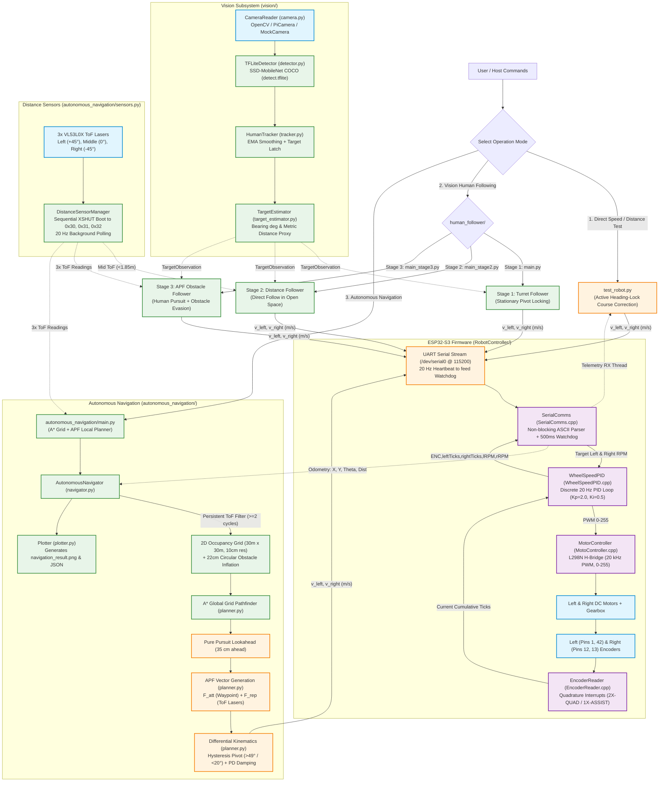

# CNL2 — Autonomous & Human-Following Robot Car

A two-wheeled differential-drive robotics platform combining closed-loop **ESP32-S3 motor control**, **active heading-lock straight line tracking**, **vision-based human following (Stages 1–3)**, and **2D Cartesian autonomous navigation with A* global pathfinding and APF obstacle avoidance**.

---

## Table of Contents

1. [System Architecture](#system-architecture)
2. [Hardware Requirements & Pinouts](#hardware-requirements--pinouts)
3. [Installation & Setup](#installation--setup)
4. [Operation Modes & Usage](#operation-modes--usage)
5. [Compact Configuration Reference](#compact-configuration-reference)
6. [Communication Protocol](#communication-protocol)
7. [Troubleshooting](#troubleshooting)

---

## System Architecture



---

## Hardware Requirements & Pinouts

### Hardware Components
* **Microcontroller**: ESP32-S3 Dev Module
* **Single Board Computer**: Raspberry Pi 4B (4GB / 8GB) running Raspberry Pi OS (64-bit)
* **Motor Driver**: L298N Dual H-Bridge Driver
* **Motors**: 2× Geared DC Motors with optical/Hall quadrature encoders (720 ticks/revolution)
* **Sensors**: 3× VL53L0X Time-of-Flight (ToF) Distance Sensors (I2C)
* **Vision**: Raspberry Pi Camera Module (CSI) or USB Webcam
* **Power**: 7.4V–11.1V LiPo / Li-ion battery pack for motors; 5V power supply for Raspberry Pi and ESP32

---

### Pinout Connections

#### 1. ESP32-S3 $\to$ L298N Motor Driver
| Signal | ESP32-S3 Pin | L298N Pin | Function |
|---|---|---|---|
| Left Motor PWM | **GPIO 4** | ENA | Speed control (remove black jumper!) |
| Left Motor Dir 1 | **GPIO 6** | IN1 | Direction phase 1 |
| Left Motor Dir 2 | **GPIO 5** | IN2 | Direction phase 2 |
| Right Motor PWM | **GPIO 9** | ENB | Speed control (remove black jumper!) |
| Right Motor Dir 1 | **GPIO 8** | IN3 | Direction phase 1 |
| Right Motor Dir 2 | **GPIO 7** | IN4 | Direction phase 2 |
| Ground | **GND** | GND | Common ground with battery and ESP32 |

#### 2. ESP32-S3 $\to$ Wheel Encoders
| Signal | ESP32-S3 Pin | Encoder Channel | Description |
|---|---|---|---|
| Left Encoder Phase A | **GPIO 1** | Channel A | Interrupt triggered on `CHANGE` |
| Left Encoder Phase B | **GPIO 42** | Channel B | Direction sensing (`2X-QUAD`) |
| Right Encoder Phase A | **GPIO 12** | Channel A | Interrupt triggered on `CHANGE` |
| Right Encoder Phase B | **GPIO 13** | Channel B | Direction sensing (`2X-QUAD`) |

#### 3. Raspberry Pi 4B $\to$ ESP32-S3 Serial UART
| Raspberry Pi 4B Pin | Function | ESP32-S3 Pin | Function |
|---|---|---|---|
| **Pin 8** (GPIO 14) | UART0 TXD | **GPIO 18** | ESP32 UART RX |
| **Pin 10** (GPIO 15) | UART0 RXD | **GPIO 17** | ESP32 UART TX |
| **Pin 6 or 9** | GND | **GND** | Common Logic Ground |

#### 4. Raspberry Pi 4B $\to$ 3× VL53L0X Distance Sensors (I2C)
| Signal | Raspberry Pi Pin | Sensor Pin | Description |
|---|---|---|---|
| I2C SCL | **Pin 5** (GPIO 3) | SCL (shared) | Common I2C clock bus |
| I2C SDA | **Pin 3** (GPIO 2) | SDA (shared) | Common I2C data bus |
| Power | **Pin 1** (3.3V) | VIN (shared) | 3.3V logic power |
| Ground | **Pin 6/9** (GND) | GND (shared) | Common Ground |
| Left XSHUT | **Pin 11** (GPIO 17) | XSHUT (Left Sensor) | Readdresses Left sensor to `0x30` |
| Middle XSHUT | **Pin 13** (GPIO 27) | XSHUT (Mid Sensor) | Readdresses Middle sensor to `0x31` |
| Right XSHUT | **Pin 15** (GPIO 22) | XSHUT (Right Sensor) | Readdresses Right sensor to `0x32` |

---

## Installation & Setup

### 1. Flash the ESP32-S3 Firmware
1. Open the [Arduino IDE](https://www.arduino.cc/en/software) (version 2.x recommended).
2. Install the **esp32 by Espressif Systems** board package in Boards Manager.
3. Select board: **ESP32S3 Dev Module**.
4. Set options:
   * **USB CDC On Boot**: *Enabled*
   * **Upload Speed**: *921600*
5. Open [`RobotController/RobotController.ino`](RobotController/RobotController.ino) and click **Upload**.

### 2. Configure Raspberry Pi Hardware UART & I2C
On the Raspberry Pi terminal:
```bash
sudo raspi-config
```
* **Interface Options $\to$ I2C**: Enable.
* **Interface Options $\to$ Serial Port**:
  * *Would you like a login shell to be accessible over serial?* $\to$ **No**
  * *Would you like the serial port hardware to be enabled?* $\to$ **Yes**
* Reboot the Pi:
```bash
sudo reboot
```

### 3. Install Python Dependencies
```bash
cd ~/CNL2
sudo apt update
sudo apt install -y python3-opencv python3-numpy python3-pip python3-serial

# Install Python packages
pip3 install -r teleop_host/requirements.txt
```

### 4. Verify & Download Vision Detection Model
The MobileNet SSD TFLite model is managed automatically:
```bash
python3 vision/download_model.py
```
*Ensures `vision/models/detect.tflite` (300×300 COCO quantized) and `labelmap.txt` are verified and ready for inference.*

---

## Operation Modes & Usage

### 1. Standalone Speed & Distance Test (`test_robot.py`)
Provides direct velocity testing with active **PD Heading-Lock Course Correction**:
```bash
python3 test_robot.py
```
* `move 1 m` $\to$ Moves forward 1.0m while actively correcting heading drift.
* `move 2 m 0.3` $\to$ Moves 2.0m at custom cruise speed ($0.3\text{ m/s}$).
* `move -0.5 m` $\to$ Drives in reverse 0.5m.
* `stop` $\to$ Immediate halt.

---

### 2. Vision Human Following (`human_follower/`)
Tracks a person in real time using the camera and 3× ToF sensors.

#### Stage 1: Stationary Turret Pivot
Pivots on the spot to keep the person centered in view with PD anti-overshoot easing:
```bash
python3 human_follower/main.py
```

#### Stage 2: Distance Tracking Follower
Maintains a calibrated distance (~1.2m) in open space using ToF laser fusion and curvature steering:
```bash
python3 human_follower/main_stage2.py
```

#### Stage 3: Human Follower with APF Obstacle Avoidance
Follows human target while dynamically steering around obstacles using 3× ToF sensors and APF vector blending:
```bash
python3 human_follower/main_stage3.py
```

**Common Options for Human Follower:**
* `--headless` $\to$ Runs over SSH without an X11 preview window.
* `--mock` $\to$ Runs in synthetic simulation mode (no camera or ESP32 needed).
* `--target-dist 1.5` $\to$ Sets custom following distance (meters).
* `--max-speed 0.35` $\to$ Sets maximum forward cruising speed (m/s).

---

### 3. Autonomous 2D Cartesian Navigation (`autonomous_navigation/`)
Full-featured 2D grid mapping, global A\* path planning, and local APF avoidance.

#### Interactive Shell Mode:
```bash
python3 -m autonomous_navigation.main
```
Available interactive commands:
* `goto 1.5 2.0` $\to$ Navigates to coordinate $(X=1.5\text{m}, Y=2.0\text{m})$ avoiding obstacles.
* `move 2.5 m 0.4` $\to$ Drives straight for 2.5 meters.
* `sensors` $\to$ Displays live readings from Left, Middle, and Right ToF sensors.
* `pose` $\to$ Prints dead-reckoning position $(X, Y, \theta)$ and distance travelled.
* `plot` $\to$ Saves current path and obstacle map to `navigation_result.png`.
* `stop` $\to$ Emergency stop.

#### Direct CLI Execution:
```bash
# Coordinate goal navigation
python3 -m autonomous_navigation.main --goal 1.5 1.0 --speed 0.4

# Desktop mock simulation (generates map without hardware)
python3 -m autonomous_navigation.main --mock --goal 1.0 1.0 --speed 0.6
```

---

## Compact Configuration Reference

### Robot Physical Geometry
| Parameter | Value | Location | Description |
|---|---|---|---|
| `WHEEL_RADIUS_M` | `0.0215 m` | `Config.h`, `config.py` | Wheel radius (2.15 cm) |
| `WHEEL_BASE_M` | `0.134 m` | `Config.h`, `config.py` | Distance between left & right wheels (13.4 cm) |
| `TICKS_PER_REV` | `720.0` | `Config.h`, `config.py` | Encoder pulses per wheel turn |

### ESP32 Firmware Constants (`RobotController/Config.h`)
| Parameter | Value | Description |
|---|---|---|
| `PID_SAMPLE_TIME_MS` | `50 ms` (20 Hz) | Discrete PID update interval |
| `PID_KP`, `PID_KI`, `PID_KD` | `2.0`, `0.5`, `0.0` | Wheel velocity PID gains |
| `COMMAND_TIMEOUT_MS` | `500 ms` | Watchdog timeout (cuts motors if link lost) |
| `MOTOR_PWM_FREQUENCY`| `20000 Hz` | Ultrasonic PWM frequency (no motor whine) |

### Navigation Constants (`autonomous_navigation/config.py`)
| Parameter | Value | Description |
|---|---|---|
| `GRID_SIZE_X`, `Y` | `30.0 m` | Occupancy grid dimension (-15m to +15m) |
| `GRID_RES` | `0.10 m` (10 cm) | Grid cell resolution |
| `ROBOT_CLEARANCE_RADIUS` | `0.22 m` | Circular inflation radius around obstacles |
| `LOOKAHEAD_DIST_M` | `0.35 m` | Pure Pursuit lookahead distance along path |
| `GOAL_TOLERANCE_M` | `0.08 m` | Arrival distance tolerance |
| `MAX_REP_FORCE` | `2.0` | Saturation cap on APF repulsive vector |
| `MAX_ACCEL_MPS2` | `0.80 m/s²` | Slew-rate linear acceleration limit |
| `MAX_DECEL_MPS2` | `1.20 m/s²` | Slew-rate linear deceleration limit |
| `PIVOT_ENTER_RAD` | `0.85 rad` (~49°) | In-place pivot entry threshold |
| `PIVOT_EXIT_RAD` | `0.35 rad` (~20°) | In-place pivot exit threshold (hysteresis) |
| `OBSTACLE_PERSISTENCE`| `2 cycles` | Filter against floor bounce and noise spikes |

### Vision Pipeline Constants (`vision/config.py`)
| Parameter | Value | Description |
|---|---|---|
| `camera_width`, `height`| `640 x 480` | Frame capture resolution |
| `input_width`, `height` | `300 x 300` | TFLite model input resolution |
| `confidence_threshold` | `0.40` | Person detection acceptance threshold |
| `ema_alpha` | `0.65` | Bounding box temporal smoothing factor |
| `track_lost_timeout_s` | `1.5 s` | Target timeout before triggering search recovery |

---

## Communication Protocol

### Raspberry Pi $\to$ ESP32 (Velocity Packet)
* **Stream Rate**: 20 Hz (every 50 ms)
* **Format**: `<v_left>,<v_right>\n` as ASCII text (velocities in m/s)
* **Example**: `0.350,0.350\n` (forward cruise), `0.150,-0.150\n` (pivot right)
* **Watchdog Failsafe**: ESP32 halts motors if no packet is received for > 500 ms.

### ESP32 $\to$ Raspberry Pi (Telemetry Packet)
* **Stream Rate**: 20 Hz (every 50 ms)
* **Format**: `ENC,<leftTicks>,<rightTicks>,<leftRPM>,<rightRPM>\n`
* **Example**: `ENC,1440,1438,42.1,42.0\n`

---

## Troubleshooting

1. **Motors cut out after 0.5 seconds**:
   * Watchdog timer tripped. The host script must transmit velocity commands at $\ge 10\text{ Hz}$ (default scripts stream at 20 Hz).
2. **Left wheel RPM always positive in both directions**:
   * Left encoder Phase B wire disconnected or loose on GPIO 42. Check crimp connector.
3. **Robot drifts when driving straight in `test_robot.py`**:
   * Confirm `ENABLE_HEADING_LOCK = True` in `test_robot.py`.
4. **ToF sensor initialization errors**:
   * Verify I2C wiring on Raspberry Pi Pins 3 (SDA) and 5 (SCL), and ensure all 3 XSHUT wires are firmly connected to GPIOs 17, 27, and 22.
5. **Permission denied on `/dev/serial0`**:
   ```bash
   sudo usermod -aG dialout,i2c $USER
   # Log out and log back in for changes to take effect
   ```
